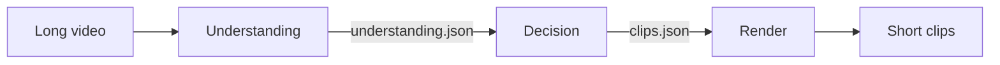
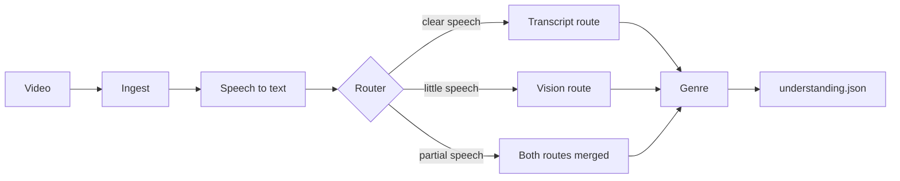

<div align="center">

# Kairos

**Turn one long video into short, vertical, ready to post clips.**


Final year project by Rameen Arshad, Adina Fatima and Muhammad Ahmad

[Overview](#overview) | [Pipeline](#pipeline) | [Status](#status) | [Quick start](#quick-start) | [Contracts](#contracts) | [Team workflow](#team-workflow)

</div>

---

## Overview

Kairos takes a long video, finds the moments worth sharing and turns them into short vertical clips with captions. The work is split into three layers that talk to each other only through JSON files with a fixed format. This lets the three of us build in parallel without blocking each other.

## Pipeline



| Layer | What it does | Owner |
|---|---|---|
| Understanding | Reads the video, transcribes speech, picks an analysis route and labels the genre | Rameen |
| Decision | Finds the best moments, scores them and ranks them | Ahmad |
| Render | Cuts the clips, crops to vertical and adds captions | Adina |

### Inside the understanding layer



The router uses speech_ratio, asr_confidence and words per minute:

| Route | When | What is used |
|---|---|---|
| transcript | enough clear speech | the transcript |
| vision | little or no speech | frame descriptions from a vision model |
| both | partial speech | transcript and frame descriptions merged |

The thresholds are placeholders in `understanding/config.py` and will be tuned from our test videos.

## Status

| Part | Status |
|---|---|
| Contracts and fake fixtures | Done |
| Ingest (ffprobe and FFmpeg) | Done |
| Speech to text (faster-whisper, cached) | Done |
| Router | Working, thresholds still to tune |
| Vision path | Stub (no model call yet) |
| Genre classifier | Stub (no model call yet) |
| Decision | In progress |
| Render | In progress |
| API and web | Not started |

## Quick start

You need Python 3.12 and FFmpeg (ffmpeg and ffprobe on your PATH). Commands are for Windows PowerShell.

```powershell
git clone https://github.com/raminionn/Kairos.git
cd Kairos
python -m venv .venv
.\.venv\Scripts\Activate.ps1
pip install -r requirements.txt
copy .env.example .env
```

The first speech to text run downloads the Whisper small model (about 480 MB, one time).

Put a video in `data/videos/` and run:

```powershell
python -m understanding.run data/videos/my_video.mp4
```

This writes `data/work/my_video/understanding.json`. Until the vision path and genre classifier are built, the output shows STUB lines and genre is `unknown`.

Route report over every video in `data/videos/` (writes `scratch/route_report.csv`):

```powershell
python -m eval.route_report
```

Run the tests (no models, no API calls, no key needed):

```powershell
python -m pytest contracts understanding -q
```

## Contracts

| File | What it holds | Written by |
|---|---|---|
| media.json | Facts about the source video: size, duration, fps, rotation and the extracted audio file | Ingest |
| understanding.json | Transcript, route, genre and segments | Understanding layer |

Rules for every file:

- Paths are relative to the repo root and use forward slashes.
- Unknown fields are rejected, so a typo fails loudly.
- `rotation` is the clockwise degrees needed to turn the frame upright.
- `genre` must be one of: talk, lecture, vlog, gaming, cooking, other, unknown. The list lives only in `contracts/genres.py`.

Small fake example files for each contract are in `fixtures/`.

## Folders

```text
contracts/    file formats passed between layers, with validation
fixtures/     fake example files for each contract
understanding/ ingest, speech to text, router, vision path, genre
decision/     clip selection, scoring, ranking
render/       cutting, vertical crop, captions
api/          backend, job queue, database
web/          frontend
eval/         evaluation scripts
```

The folders `data/`, `scratch/` and `docs/` are local only and are not in Git. Generated files go under `data/` (work files in `data/work/<video_id>/` and the speech to text cache in `data/cache/asr/`).

## Team workflow

- `main` is protected. Nothing goes in without a pull request and one approval from another teammate.
- Each person works on their own branch: `rameen/understanding`, `ahmad/decision`, `adina/render`.
- Push to your branch as often as you like. Open a pull request when a piece of work is ready for review.

## Screenshots

Coming soon.